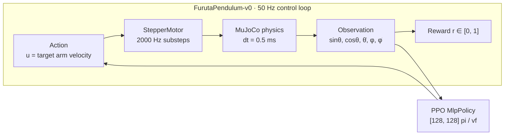
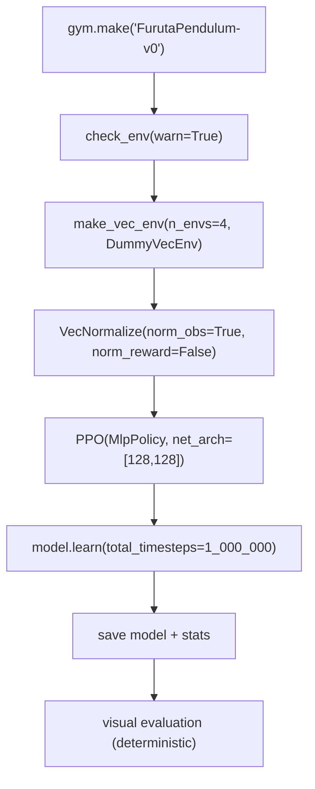

# Furuta Pendulum — Gym Environment & PPO Training Documentation

> Single source of truth for the **`FurutaPendulum-v0`** Gymnasium environment and
> the **PPO** training pipeline (stable-baselines3). This document maps the
> environment (action/observation definitions, dynamics, reward function) to the
> reinforcement-learning setup used to train the swing-up + balance controller.
>
> Ground-truth sources:
>
> | File | Purpose |
> | --- | --- |
> | `simulation/envs/pendulum_env.py` | `FurutaEnv` — spaces, `reset`, `step`, reward |
> | `simulation/envs/__init__.py` | `FurutaPendulum-v0` registration |
> | `simulation/envs/stepper_motor.py` | `StepperMotor` — 17HS4401 electromechanical model |
> | `training/training_sb_PPO.py` | PPO training script |

---

## 1. System overview

The agent commands a **target angular velocity** for the stepper-driven arm. The
electromechanical stepper model converts that command into a physical torque,
MuJoCo integrates the physics, and the resulting state is fed back to the PPO
policy. The episode terminates on stepper stall or when the arm exceeds one full
turn in either direction.

---

## 2. Environment: `FurutaPendulum-v0`

### 2.1 Registration

Defined in `simulation/envs/__init__.py`:

| Attribute | Value |
| --- | --- |
| `id` | `FurutaPendulum-v0` |
| `entry_point` | `simulation.envs.pendulum_env:FurutaEnv` |
| `max_episode_steps` | `1000` (truncation limit) |

### 2.2 Action space

`gymnasium.spaces.Box(low=-15.0, high=15.0, shape=(1,), dtype=float32)`

| Item | Value |
| --- | --- |
| Meaning | Target angular velocity of the arm / stepper rotor |
| Symbol | $u$ |
| Range | $u \in [-15,\ 15] \; \text{rad/s}$ |
| Limit source | `stepper_motor.MAX_SPEED = 15.0` rad/s |

The scalar is clipped internally to `[-MAX_SPEED, MAX_SPEED]` before being passed
to the stepper model. The stepper model additionally enforces an acceleration
limit of `MAX_ACCEL = 300.0` rad/s², so the commanded field velocity is ramped
rather than applied instantaneously.

### 2.3 Observation space

`gymnasium.spaces.Box` with `high = [1, 1, ∞, ∞, ∞]` (symmetric `low = -high`),
`dtype=float32`.

| Index | Symbol | Description | Range |
| --- | --- | --- | --- |
| 0 | $\sin\theta$ | sine of pendulum angle | $[-1, 1]$ |
| 1 | $\cos\theta$ | cosine of pendulum angle | $[-1, 1]$ |
| 2 | $\dot\theta$ | pendulum angular velocity | $\mathbb{R}$ |
| 3 | $\phi$ | motor / arm angle | $\mathbb{R}$ |
| 4 | $\dot\phi$ | motor / arm angular velocity | $\mathbb{R}$ |

Angle conventions:

- $\theta$ is the **pendulum** angle measured from the hanging-down position
  (`qpos[1]`): $\theta = 0$ hangs down ($\cos\theta = 1$), $\theta = \pi$ is
  upright ($\cos\theta = -1$).
- $\phi$ is the **motor / arm** angle (`qpos[0]`), unbounded (can accumulate
  multiple turns until the $\pm 2\pi$ arm limit triggers).

### 2.4 Control & physics rates

| Rate | Value | Source |
| --- | --- | --- |
| Physics timestep | $0.5\ \text{ms}$ (2000 Hz) | MuJoCo XML `timestep` |
| Control timestep | $20\ \text{ms}$ (50 Hz) | `frame_skip = 40` × 0.5 ms |
| Stepper substeps | per physics step (2000 Hz) | `stepper.compute_torque` each `mj_step` |

One `env.step(action)` runs `frame_skip = 40` MuJoCo substeps, each advancing the
stepper model and physics by 0.5 ms. Substepping stops early if the motor stalls.

### 2.5 Reset — initial-state distribution

`reset()` re-initialises MuJoCo to `qpos0` plus small uniform noise
($\pm 0.05$ on positions and velocities), then uses a **hybrid** initialisation
for the pendulum angle $\theta$:

| Probability | Initial pendulum angle $\theta$ | Purpose |
| --- | --- | --- |
| 50% | $\pi \pm 0.3$ rad (near upright) | learn braking + balancing quickly |
| 50% | $\mathrm{Uniform}[-\pi, \pi]$ | learn the full swing-up trajectory |

The stepper's magnetic-field angle is synchronised to the starting arm angle
(`stepper.reset(initial_theta=qpos[0])`).

### 2.6 Termination & truncation

| Condition | Flag | Effect |
| --- | --- | --- |
| Stepper stall (electrical lag > 2 full steps = 3.6°) | `terminated` | reward forced to 0.0 |
| Arm limit hit: $\lvert\phi\rvert > 2\pi$ | `terminated` | reward forced to 0.0 |
| Episode length reaches 1000 steps | `truncated` | normal TimeLimit reset |

The `info` dict returned by `step()` contains:

| Key | Meaning |
| --- | --- |
| `motor_lag_deg` | electrical lag in degrees |
| `stalled` | `True` if stepper lost synchronisation |
| `arm_limit_hit` | `True` if $\lvert\phi\rvert > 2\pi$ |
| `applied_torque` | last applied control torque [N·m] |

### 2.7 Reward function

The reward is **strictly non-negative**, bounded in $[0, 1]$, and returns
$0.0$ immediately if the stepper has stalled:

$$
r =
\begin{cases}
0, & \text{if stalled} \\[4pt]
0.05 \cdot f_\mathrm{up} \;+\; 0.95 \cdot f_\mathrm{up} \cdot d_\mathrm{vel} \cdot d_\mathrm{arm}, & \text{otherwise}
\end{cases}
$$

with the three factors:

**1. Upright-posture factor** $f_\mathrm{up} \in [0, 1]$ — hanging down
($\cos\theta = 1$) gives $0$, upright ($\cos\theta = -1$) gives $1$:

$$
f_\mathrm{up} = \left(\tfrac{1}{2}\left(1 - \cos\theta\right)\right)^{2}
$$

**2. Pendulum velocity damping** $d_\mathrm{vel} \in (0, 1]$ — penalises swing
energy so the agent brakes at the top instead of spinning through it:

$$
d_\mathrm{vel} = \exp\left(-0.3\,\dot\theta^{2}\right)
$$

**3. Arm centring & control damping** $d_\mathrm{arm} \in (0, 1]$ — keeps the
arm near zero and smooths both arm speed and the commanded velocity:

$$
d_\mathrm{arm} = \exp\left(-0.05\,\phi^{2} - 0.005\,\dot\phi^{2} - 0.002\,u^{2}\right)
$$

> **Why the 0.05 / 0.95 split:** 95% of the reward is gated behind the product
> $f_\mathrm{up}\,d_\mathrm{vel}\,d_\mathrm{arm}$, so merely swinging through the
> upright position yields almost no reward; the agent must stop and hold the
> pendulum upright with a centred, slow arm to score near 1.0.

---

## 3. PPO training setup

Defined in `training/training_sb_PPO.py` (run with
`uv run python -m training.training_sb_PPO`).

### 3.1 Pipeline

### 3.2 Vectorised environments

| Parameter | Value |
| --- | --- |
| Env factory | `make_vec_env(env_id, n_envs=4, seed=42, vec_env_cls=DummyVecEnv)` |
| Parallel envs | 4 |

### 3.3 Observation normalisation (`VecNormalize`)

| Parameter | Value | Rationale |
| --- | --- | --- |
| `norm_obs` | `True` | normalise the 5-dim observation |
| `norm_reward` | `False` | reward already lives in $[0, 1]$ |
| `clip_obs` | `10.0` | clip normalised obs to $\pm 10$ |
| `gamma` | `0.995` | running mean/var discount |

### 3.4 Policy architecture

| Item | Value |
| --- | --- |
| Policy | `MlpPolicy` |
| `pi` hidden layers | `[128, 128]` |
| `vf` hidden layers | `[128, 128]` |
| Activation | `tanh` (SB3 `MlpPolicy` default) |

### 3.5 PPO hyperparameters

| Hyperparameter | Value |
| --- | --- |
| `learning_rate` | linear schedule $3\times10^{-4} \to 5\times10^{-5}$ |
| `n_steps` | 1024 |
| `batch_size` | 128 |
| `n_epochs` | 5 |
| `gamma` | 0.995 |
| `gae_lambda` | 0.95 |
| `clip_range` | 0.2 |
| `target_kl` | 0.02 |
| `seed` | 42 |
| `device` | `cpu` |
| `total_timesteps` | 1 000 000 |

The discount $\gamma = 0.995$ corresponds to an effective planning horizon of
$\tfrac{1}{1-\gamma} \approx 200$ steps, i.e. ~4 s at the 50 Hz control rate.

### 3.6 Learning-rate schedule

A linear decay from the initial to the final value as `progress_remaining`
goes from 1.0 → 0.0:

$$
\mathrm{lr}(p) = 5\times10^{-5} + p \cdot (3\times10^{-4} - 5\times10^{-5})
$$

### 3.7 Saved artifacts

| Artifact | Path |
| --- | --- |
| PPO policy | `training/logs/ppo_furuta_pendulum.zip` |
| Normalisation stats | `training/logs/vec_normalize.pkl` |

### 3.8 Evaluation

After training, the script loads the policy **deterministically** into a single
rendered environment with frozen normalisation statistics
(`eval_env.training = False`, `eval_env.norm_reward = False`) and rolls out 1000
steps (20 s) at 50 Hz, resetting on episode end.

---

## 4. Full reward-to-action mapping (summary)

| Quantity | Symbol | Formula / value |
| --- | --- | --- |
| Action (target arm velocity) | $u$ | $\in [-15, 15]\ \text{rad/s}$ |
| Upright factor | $f_\mathrm{up}$ | $\left(\frac{1-\cos\theta}{2}\right)^2$ |
| Velocity damping | $d_\mathrm{vel}$ | $\exp(-0.3\,\dot\theta^2)$ |
| Arm damping | $d_\mathrm{arm}$ | $\exp(-0.05\phi^2 - 0.005\dot\phi^2 - 0.002u^2)$ |
| Reward | $r$ | $0.05 f_\mathrm{up} + 0.95 f_\mathrm{up} d_\mathrm{vel} d_\mathrm{arm}$ |

## 5. PPO Training Conclusions – Furuta Pendulum (MuJoCo + NEMA 17, 50 Hz)

### a) Achieved Results (100-Episode Benchmark)

Switching to a **50 Hz** control loop (`frame_skip=40`, `dt=0.02 s`, providing a comfortable compute margin for future Raspberry Pi deployment) and aligning the environment physics with PPO exploration resulted in full stability without motor chattering:

| Metric | Final Result |
|---|---|
| **Success Rate (Settled >= 1s)** | **100.0 %** |
| **Stepper Motor Stall Rate** | **0.0 %** |
| **Mean Episode Return** | **920.03 +/- 64.01** (out of 1000 max) |
| **Balanced Zone Angle RMSE** | **0.014 rad** (~0.8°) |
| **Time Spent Upright (<11°)** | **95.5 %** |
| **Bottom Swing-Up Time (sample episodes)** | **2.1 – 4.7 s** (smooth energy pumping) |

*Methodological note: The reported mean settling time (1.48 s +/- 1.58 s) includes 50% of episodes initialized near the upright position by the training `reset()`. Measuring pure swing-up performance requires a dedicated evaluation starting 100% of episodes at the bottom dead center.*

---

### b) What Did Not Work and Why

* **Additive velocity and action-rate penalties (`_compute_reward`):**
  The 3D-printed pendulum has very low mass (19.35 g) and a short center-of-mass distance (3.06 cm). By conservation of energy, it requires approximately **19.6 rad/s** at the bottom to reach the upright position. Subtracting `0.02 * pendulum_vel^2` applied roughly `-8.0` penalty per step during physically necessary swing-up motion. Combined with a `-10.0` termination penalty and `action_rate_penalty`, freezing the motor at the bottom (`0.0` reward) became the mathematically optimal local strategy.
* **Normalized action space `[-1.0, 1.0]` scaled by `MAX_SPEED = 15.0`:**
  PPO's default initial exploration noise (`std = 1.0`) mapped directly to random **+/- 15 rad/s** velocity commands every 20 ms from step zero. This caused severe high-frequency chattering and forced artificial damping via penalties.
* **gSDE exploration with low `log_std_init=-2.0` and `ent_coef=0.0`:**
  A small initial standard deviation sharply increased KL divergence sensitivity (triggering frequent early stopping at epoch `step 0`). Without an entropy bonus, `std` collapsed to `0.0268` mid-training, freezing exploration in a poor local optimum.
* **Bimodal `reset()` distribution (75% bottom / 25% upright):**
  Removing intermediate angles broke the learning path. The policy only mastered the 25% of easy upright starts and failed to bridge the gap from rest at the bottom to upright stabilization.
* **Unconstrained PPO updates (`n_epochs=10` without `target_kl`):**
  Excessively aggressive updates on a single rollout buffer caused KL spikes (up to `0.17`) and sudden policy collapse.
* **Combined termination diagnostics in `info["stalled"]`:**
  Reporting both physical stepper pull-out (`stepper.stalled`) and arm rotation limit violations (`+/- 2*pi`) under a single flag obscured the real cause of early episode terminations.

---

### c) What Worked and Why

* **Multiplicative, strictly non-negative reward in `[0.0, 1.0]`:**
  Splitting the reward into a base shaping term `0.2 * upright_factor` and a gated bonus `0.8 * (upright_factor * vel_damping * arm_damping)` decoupled swing-up from stabilization. The pendulum can build momentum freely at the bottom without incurring negative penalties, while braking and arm centering are enforced near the top. Keeping `norm_reward=False` in `VecNormalize` preserved this clean scale.
* **Unnormalized action space `[-15.0, 15.0]` with standard Gaussian noise:**
  At this scale, PPO's default `std = 1.0` naturally samples gentle initial velocities around **+/- 1 rad/s**, encouraging smooth energy pumping without chattering while retaining the full NEMA 17 speed range for upright braking.
* **Hybrid 50/50 `reset()` (50% near upright / 50% full circle):**
  Intermediate angles acted as an automatic reverse curriculum, allowing the policy to gradually extend its capture region from near the top all the way down to a full bottom swing-up.
* **Balanced PPO stabilization for 50 Hz:**
  Combining `n_epochs=5`, `target_kl=0.02`, linear `learning_rate` decay (`3e-4 -> 5e-5`) over `1,000,000` timesteps, and an extended `gamma=0.995` (~4-second horizon at 50 Hz) prevented policy collapse and allowed the agent to credit multi-swing energy pumping toward later upright rewards.
* **Separated diagnostic flags in `step()`:**
  Logging `stalled` and `arm_limit_hit` independently confirmed clean stepper motor behavior (0% loss of synchronization).

---

### d) Key Design Takeaways

1. **Audit physics before tuning hyperparameters:** When a policy gets stuck in a local optimum or chatters, the root cause is usually a conflict between the reward function, noise scale, and physical dynamics rather than optimizer hyperparameters.
2. **Avoid patching symptoms with extra penalties:** Adding negative velocity or acceleration terms in swing-up tasks often blocks physically required trajectories or induces harsh bang-bang control.
3. **Match initial exploration scale to physical action bounds:** Initial `std` must be proportional to the physical action range; otherwise, exploration either turns into violent chattering or collapses prematurely.
